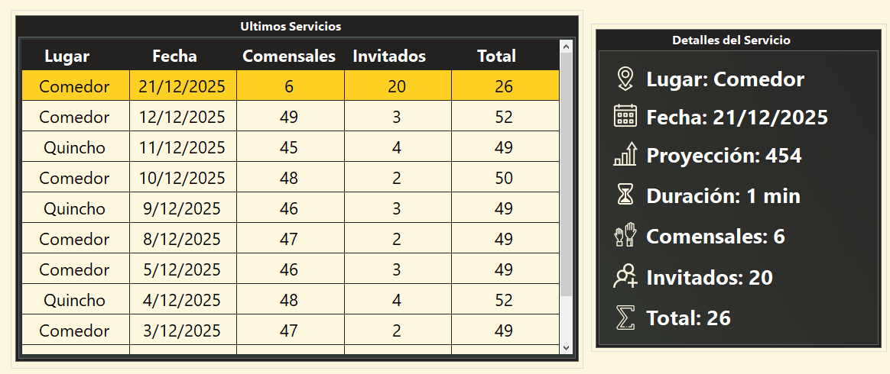
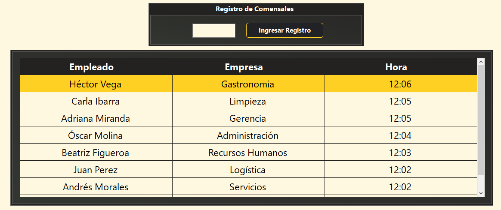
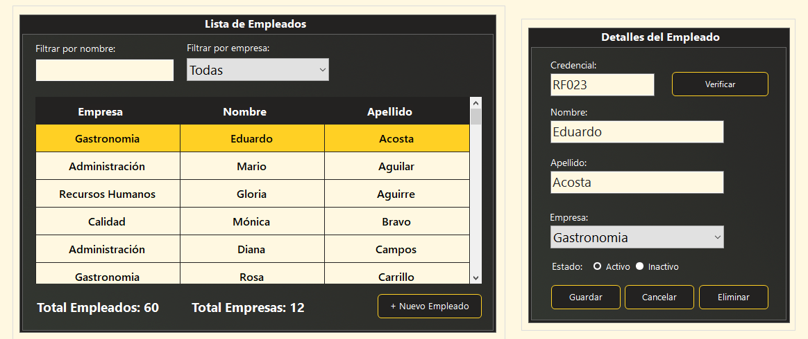
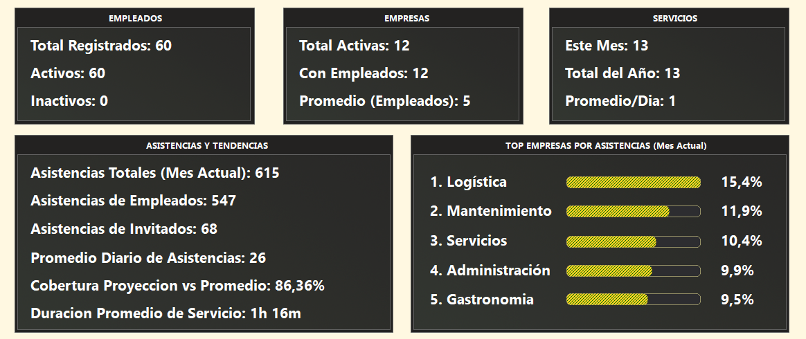
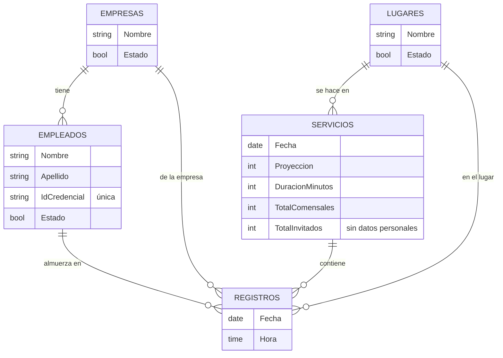

# SCA · Sistema Control de Almuerzos

Aplicación de escritorio para controlar los almuerzos de un comedor corporativo: registra a cada comensal con su credencial, lo compara con lo proyectado y genera reportes en PDF.

**Contexto:** primera versión del sistema. La versión actual es [SCA-MVC](https://github.com/f-Rra/Control-Almuerzos-MVC), una aplicación web publicada en Azure.

## Capturas

| | |
|---|---|
|  |  |
| Últimos servicios y el detalle de cada uno | Registro de comensales, el más reciente arriba |
|  |  |
| Empleados, con su credencial y su empresa | Estadísticas y ranking de empresas |

## Stack

.NET Framework 4.8.1 · C# · Windows Forms (ReaLTaiizor) · ADO.NET · SQL Server (procedimientos almacenados, vistas y un trigger) · iTextSharp.

## Modelo de datos

Un empleado no puede registrarse dos veces en el mismo servicio: lo garantizan una restricción única y un trigger en la base.

## Arquitectura

- **Presentación:** una ventana principal con un `UserControl` por módulo (servicio, registro manual, empleados, empresas, reportes, estadísticas, configuración) y gestores para el cronómetro y la navegación.
- **Negocio y dominio:** una clase `*Negocio` por entidad, que accede a los datos con `AccesoDatos` (liberada con `using`) y convierte las filas en objetos con mappers; los errores de la base se traducen a `NegocioException`, con un mensaje que entiende el usuario.
- **Datos:** SQL Server. Las operaciones van por procedimientos almacenados con parámetros; las consultas de lectura usan vistas.

## Qué cambió en la versión web

- **Del escritorio a la web.** Windows Forms con ADO.NET pasó a ASP.NET Core MVC con Entity Framework Core, publicada en Azure.
- **Acceso con usuarios y roles.** El escritorio no pedía inicio de sesión; la versión web usa ASP.NET Core Identity con roles de administrador y usuario.
- **Lectores de red, tests y CI.** Una API REST para lectores RFID por Wi-Fi, 83 tests y un CI que los corre en cada push.

Está en [Control-Almuerzos-MVC](https://github.com/f-Rra/Control-Almuerzos-MVC).

## Autor

- Estudiante de la Tecnicatura Universitaria en Programación - UTN FRGP
- Email: [facundo.rra@gmail.com](mailto:facundo.rra@gmail.com)
